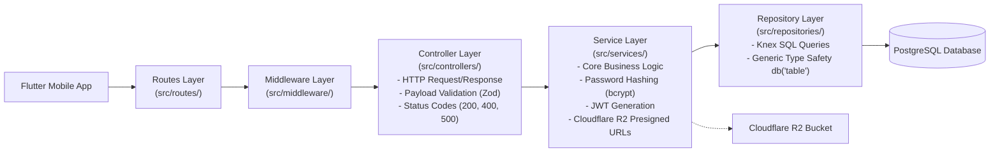

# Backend Layered Architecture (Node.js + Express + Knex + PostgreSQL)

This document outlines the **3-Layer Service Architecture** used in the Pulse backend codebase.

---

## 🏗️ Architecture Overview

The backend uses a strict **Decoupled 3-Layer Architecture** to enforce separation of concerns, testability, and clean code boundaries.



---

## 🧱 Layer Breakdown & Responsibilities

### 1. Routes Layer (`src/routes/`)
* **Responsibility:** Maps API endpoints to specific controller methods.
* **Middleware:** Applies authentication (`authenticateToken`), rate-limiting, and validation middleware.
* **Example:** `src/routes/auth-routes.ts`, `src/routes/upload-routes.ts`

### 2. Controller Layer (`src/controllers/`)
* **Responsibility:** Manages the HTTP interface (`req: Request`, `res: Response`).
* **Tasks:**
  * Parses and validates request bodies using **Zod** schemas.
  * Calls Service Layer methods.
  * Formats and returns standardized JSON responses with proper HTTP status codes (`200 OK`, `201 Created`, `400 Bad Request`, `401 Unauthorized`, `500 Server Error`).
* **Example:** `auth-controller.ts`, `upload-controller.ts`

### 3. Service Layer (`src/services/`)
* **Responsibility:** Encapsulates pure domain logic and business rules.
* **Tasks:**
  * Hashes raw passwords with `bcrypt`.
  * Generates and verifies JWT tokens (`jsonwebtoken`).
  * Generates 15-minute Presigned Upload URLs for **Cloudflare R2** via `@aws-sdk/s3-request-presigner`.
  * Decoupled completely from HTTP requests (`req`/`res`) and SQL queries.
* **Example:** `auth-service.ts`, `r2-service.ts`

### 4. Repository Layer (`src/repositories/`)
* **Responsibility:** Handles direct database access and execution of Knex.js queries.
* **Tasks:**
  * Executes SQL queries against PostgreSQL (`db('users').where()`, `.insert()`, `.update()`).
  * Uses TypeScript Generics `db<User>('users')` for 100% type-safe query results.
  * Does **NOT** contain business logic or HTTP status codes.
* **Example:** `user-repository.ts`

---

## 📁 Directory & File Conventions

| Layer | Path | Naming Convention | Example |
| :--- | :--- | :--- | :--- |
| **Routes** | `src/routes/` | `<feature>-routes.ts` | `auth-routes.ts` |
| **Controllers** | `src/controllers/` | `<feature>-controller.ts` | `auth-controller.ts` |
| **Services** | `src/services/` | `<feature>-service.ts` | `auth-service.ts` |
| **Repositories** | `src/repositories/` | `<domain>-repository.ts` | `user-repository.ts` |
| **Database** | `src/database/` | Knex migrations/seeds | `01_seed_users.ts` |

---

## 🛠️ Code Example: Layer Interaction

### 1. Repository (`src/repositories/user-repository.ts`)
```typescript
import db from '../database/db';
import type { User } from '../types/user';

export class UserRepository {
  async findByEmail(email: string): Promise<User | undefined> {
    return db<User>('users').where({ email }).first(); // Knex SQL Query
  }
}
```

### 2. Service (`src/services/auth-service.ts`)
```typescript
export class AuthService {
  private userRepository = new UserRepository();

  async login(email: string, password: String): Promise<{ user: User; token: string }> {
    const user = await this.userRepository.findByEmail(email);
    if (!user) throw new Error('Invalid credentials');
    
    const isMatch = await bcrypt.compare(password, user.password_hash);
    if (!isMatch) throw new Error('Invalid credentials');

    const token = this.generateToken(user.id);
    return { user, token };
  }
}
```

### 3. Controller (`src/controllers/auth-controller.ts`)
```typescript
export class AuthController {
  private authService = new AuthService();

  login = async (req: Request, res: Response): Promise<void> => {
    try {
      const { email, password } = req.body;
      const result = await this.authService.login(email, password);
      res.status(200).json({ message: 'Success', data: result });
    } catch (err: any) {
      res.status(401).json({ error: err.message });
    }
  };
}
```

---

## 🧪 Testing Standards (Jest)

Backend unit and integration tests MUST always use **Jest** (`ts-jest`):
- **Test Locations**: Colocated inside `__tests__/` subdirectories next to the source files (e.g., `src/repositories/__tests__/court-repository.test.ts`, `src/services/__tests__/court-service.test.ts`).
- **File Extension**: Must end with `.test.ts` or `.spec.ts`.
- **Framework & Tooling**: Jest runner configured via `jest.config.js` with TypeScript support.
- **Execution**: Run all tests using `npm test`.

